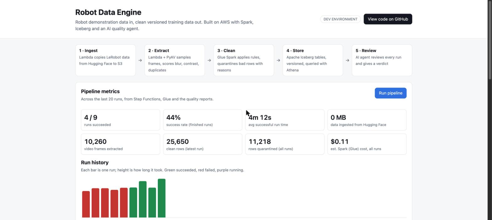

# Robot Data Engine

Serverless AWS pipeline that turns raw robot demonstration data (LeRobot PushT, time series and video)
into clean, versioned, training-ready Apache Iceberg tables, with a quality gate on every run and a live dashboard.

**Dashboard:** https://d16oog6749lx6d.cloudfront.net



## How it works

```
Step Functions (on demand)
  1. Ingest   Lambda           Hugging Face -> S3 raw/
  2. Extract  Lambda + PyAV    video -> frames + blur, brightness, contrast, duplicate scores
  3. Clean    Glue (PySpark)   rules -> Iceberg tables; rejected rows -> quarantine with reason codes
  4. Review   quality agent    verdict ok / warn / fail; a fail stops the run
Athena queries the tables; API Gateway + Lambda serve the dashboard (S3 + CloudFront).
```

**Cleaning rules:** nulls, NaN, duplicate frames, out-of-range state, timestamp and frame gaps, too-short
episodes; dark, overexposed, blurry and near-duplicate frames. Thresholds are in `infra/variables.tf`.

## Results

- 25,650 timesteps across 206 episodes cleaned
- 2,565 frames extracted, 1,522 duplicates quarantined, 1,043 clean frames
- About 4 minutes and $0.03 per run; near zero cost when idle (no schedules)

## Stack

S3, Lambda, Glue 5.0 (Spark), Apache Iceberg, Athena, Step Functions, API Gateway, CloudFront, CloudWatch,
SNS. Infrastructure as code with Terraform and CloudFormation, deployed by GitHub Actions through OIDC
(no stored AWS keys), one least-privilege IAM role per service, dev and prod with an approval gate.

## Repository

| Path | What |
| --- | --- |
| `src/rde/` | Python package: sources, storage, quality rules, services, Spark jobs, Lambda handlers |
| `jobs/glue/` | Glue entry point |
| `infra/` | Terraform |
| `web/` | Dashboard |
| `bootstrap/` | One-time AWS setup (CloudFormation) |
| `tests/` | Unit and Spark tests |

See [docs/BUILD_LOG.md](docs/BUILD_LOG.md) for how it was built, issues fixed and screenshots, and
[docs/runbook.md](docs/runbook.md) for setup and operations.
