# Build log: how Robot Data Engine was built

Built on Nov 15, 2026, from an empty repo to a deployed pipeline, API and dashboard on AWS.
Everything below is real: the screenshots are from the actual AWS account and GitHub repo.

- **Dashboard (dev):** https://d16oog6749lx6d.cloudfront.net
- **Stack:** S3, Lambda (PyAV), Glue 5.0 (Spark), Apache Iceberg, Athena, Step Functions, Bedrock,
  API Gateway, CloudFront, CloudWatch, SNS, Budgets; Terraform + CloudFormation; GitHub Actions with OIDC.

## Prototype to production

| Stage | Technical steps | Done when |
| --- | --- | --- |
| 1. Foundation | CloudFormation bootstrap: Terraform state bucket, GitHub OIDC provider, deploy role limited to `rde-*` resources | GitHub can assume the role with no stored keys |
| 2. Prototype | Ingest Lambda copies PushT to `raw/`; extract Lambda (PyAV) samples 1 frame/sec with blur, brightness, contrast, hash; Glue Spark cleans and writes Iceberg | Athena returns clean episodes and frames |
| 3. Hardening | One IAM role per service; idempotent writes (skip copied files, overwrite by `run_id` partition); quarantine table with reason codes; decode errors logged, not fatal; unit and Spark tests | Re-running a run gives the same tables |
| 4. Orchestration | Step Functions: ingest → Map(extract, 4 in parallel, retries) → Glue `.sync` → quality agent → verdict; alarms; budget | One call runs the whole pipeline |
| 5. CI/CD | PR: ruff, pytest, `terraform fmt/validate/plan`. Main: build once, `terraform apply` dev, smoke test (pipeline + API + dashboard), prod after approval | Merge deploys dev with a green smoke test |
| 6. Production | `prod` environment with required reviewer; separate bucket, roles, state; same artifacts as dev | Approved deploy, prod smoke test green |

## Timeline

1. **Project framework.** One Python package `rde` (`src/rde/`): `config`, `observability` (JSON logs),
   `storage/paths` (the only place S3 keys are built), `storage/s3`, `sources/huggingface` (retries),
   `quality` (frame metrics + cleaning rules), `services` (business logic), `spark`, `handlers` (thin Lambda entry points).
2. **Ingest service.** Lists the Hugging Face repo, copies `meta/`, `data/*.parquet` and N videos per camera
   to `raw/`; skips files already in S3 with the same size (idempotent).
3. **Extract service.** Decodes one MP4 with PyAV, samples 1 frame/sec, saves JPEGs and per-frame metrics
   (JSONL). A bad video is recorded in `processed/extract_errors/` instead of failing the run.
4. **Spark cleaning job.** Episodes: nulls, NaN, duplicate frames, out-of-range state, action spikes flagged,
   too-short episodes, frame and timestamp gaps. Frames: dark/overexposed (with low contrast), blurry,
   near-duplicate, frame-to-episode mapping by timestamp. Writes Iceberg, overwriting only this run's partition.
5. **Terraform + IAM.** Bucket, Glue catalog, Athena workgroup (10 GB scan cap), reusable Lambda module,
   Glue 5.0 job, Step Functions, alarms, budget; one least-privilege role per service.
6. **AI quality agent.** Queries Athena for the run's numbers, asks Claude on Bedrock for ok/warn/fail,
   saves a report, emails via SNS. Hard rules always win; rule-based fallback if Bedrock is unavailable.
7. **CI/CD.** `ci.yml` (PR checks and plan), `deploy.yml` + reusable `_deploy-env.yml` (dev → smoke test →
   prod after approval), `run-pipeline.yml` (on-demand button).
8. **Bootstrap as CloudFormation** (`bootstrap/bootstrap.cfn.yaml`), deployed from AWS CloudShell.
9. **First deploy and debugging** (issues below), then the first fully successful run.
10. **Read-only API + dashboard**, then **metrics + protected Run button**.

## Issues found and fixed

| # | Symptom | Root cause | Fix |
| --- | --- | --- | --- |
| 1 | Deploy stuck on "Assuming role with OIDC" | CloudTrail showed GitHub's OIDC subject now includes immutable IDs (`repo:owner@id/repo@id:...`) | Trust policy accepts the ID-based subject (survives repo renames) |
| 2 | Terraform stopped creating the state machine | Deploy role lacked `states:ValidateStateMachineDefinition` (no resource-level scoping) | Added to the read-only statement |
| 3 | Glue `UNABLE_TO_INFER_SCHEMA` | LeRobot nests files in `chunk-000/` folders; Spark does not recurse by default | `recursiveFileLookup=true` + a test on a real nested layout |
| 4 | Quality agent failed the run: 100% frames "overexposed" | PushT renders on a white background, so brightness > 245 even with visible objects | Added a `contrast` metric; exposure rules need low contrast too |
| 5 | `INSERT_COLUMN_ARITY_MISMATCH` on `video_frames` | Schema drift: table created before `contrast` existed | Iceberg schema evolution (`accept-any-schema` + `merge-schema`) |
| 6 | "Cannot write incompatible dataset" | Iceberg checks column order; Spark infers JSON columns alphabetically | Align DataFrames to the table's column order before writing |

Failed runs during this debugging were all in cleaning, the Iceberg write or the quality gate.
Ingest and frame extraction succeeded on every run.

## Results (first successful run)

- 25,650 timestep rows across 206 episodes, 0 rejected
- 2,565 frames extracted, 1,522 quarantined as near-duplicates, 1,043 clean frames
- About 4 minutes per run, about $0.03 of Glue per run, about $0 when idle (no schedules)

## Visual walkthrough

**1. CloudFormation bootstrap.** One stack creates the state bucket, OIDC provider and scoped deploy role;
its outputs become the GitHub variables.

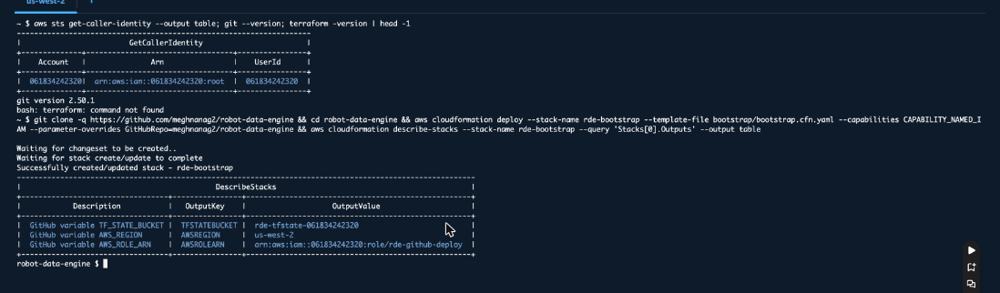

**2. Prod needs approval.** The `prod` GitHub environment requires a reviewer.

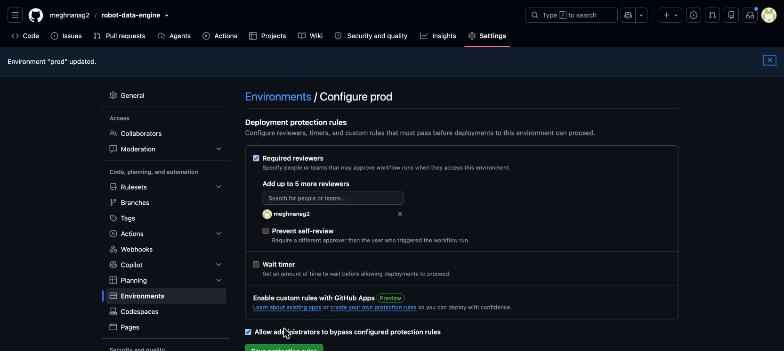

**3. Debugging the GitHub to AWS login.** CloudTrail showed `AccessDenied` and the exact OIDC subject.

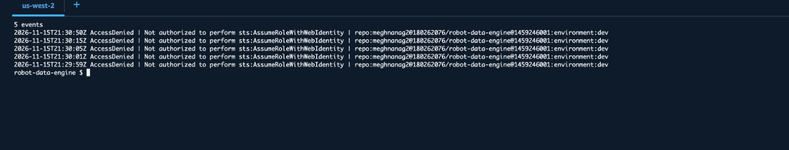

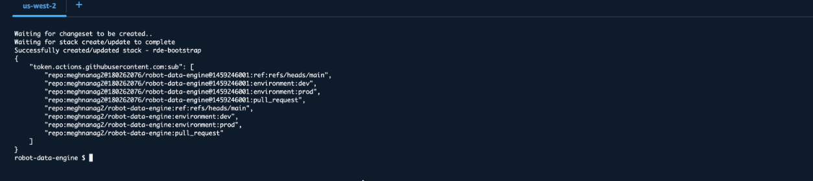

**4. Terraform deploys dev from GitHub Actions.** No console clicks.

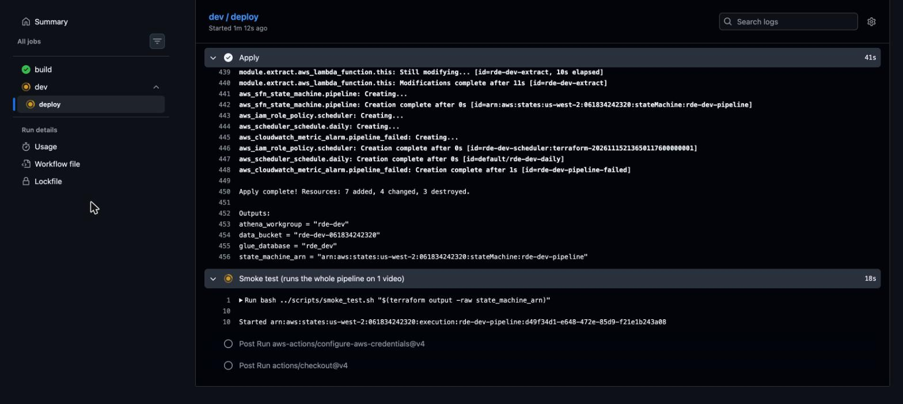

**5. The pipeline in Step Functions.**

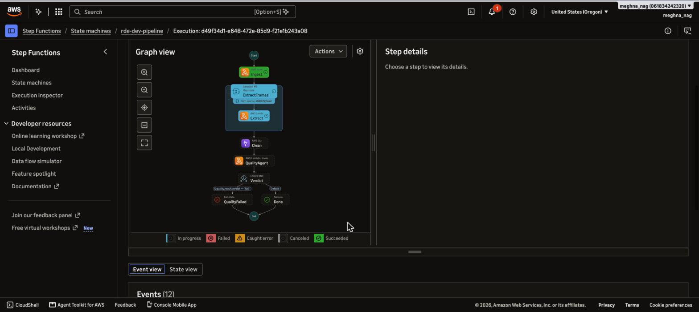

**6. Frame extraction worked:** status ok, 2,565 frames.

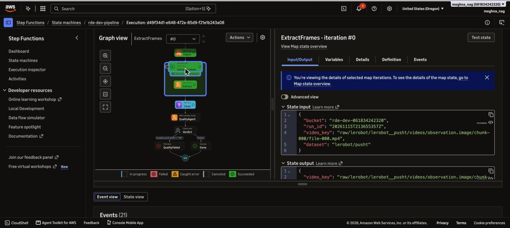

**7. Issue: Spark found no parquet files.**

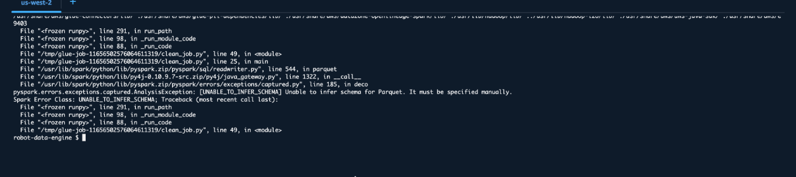

**8. Glue cleaning succeeds after the fix.**

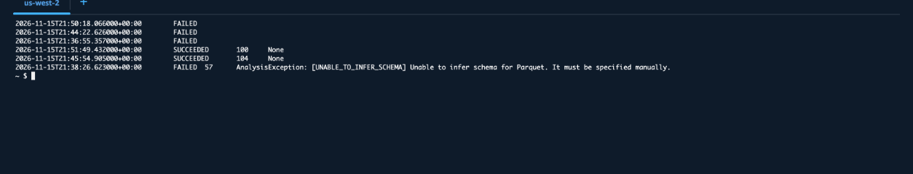

**9. Issue: the quality agent failed the run** (100% overexposed).

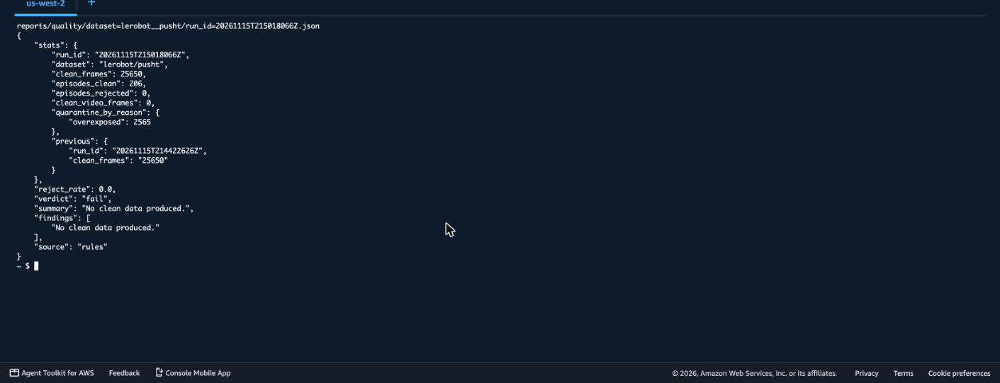

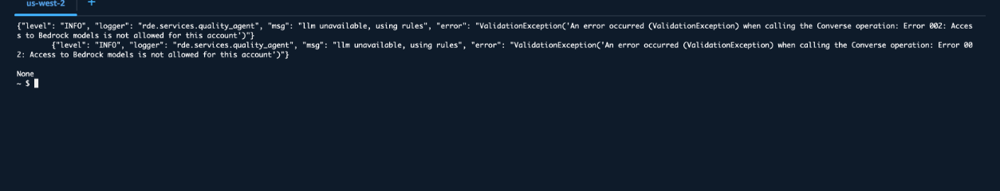

**10. Issue: schema drift.**

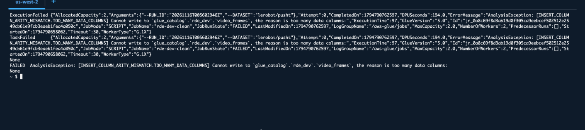

**11. First fully successful run.**

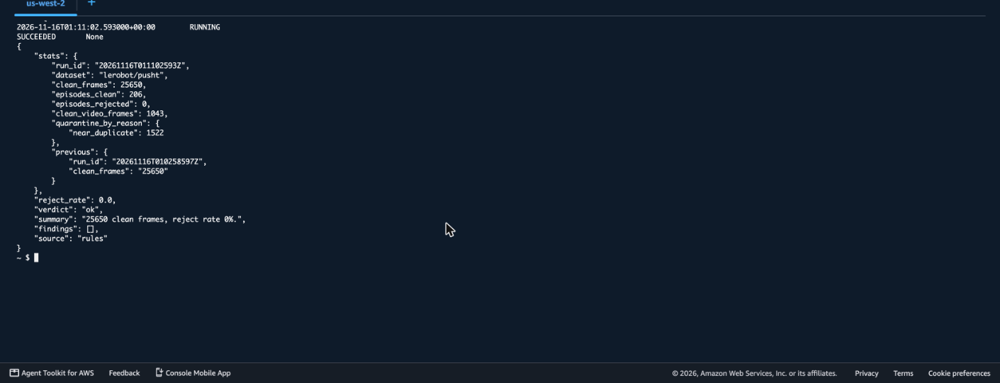

**12. Dashboard: metrics and Run button.**

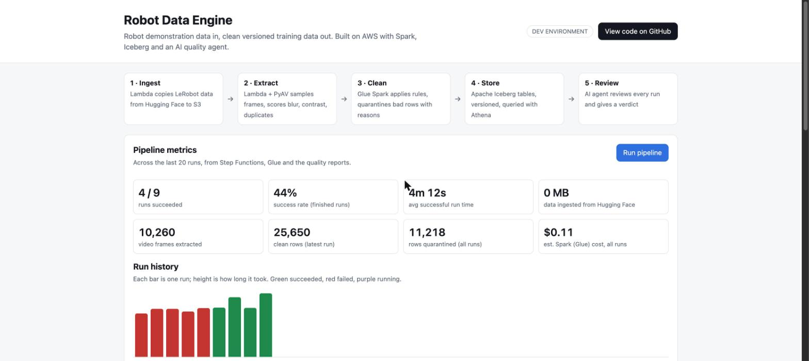

**13. Dashboard: run detail.**

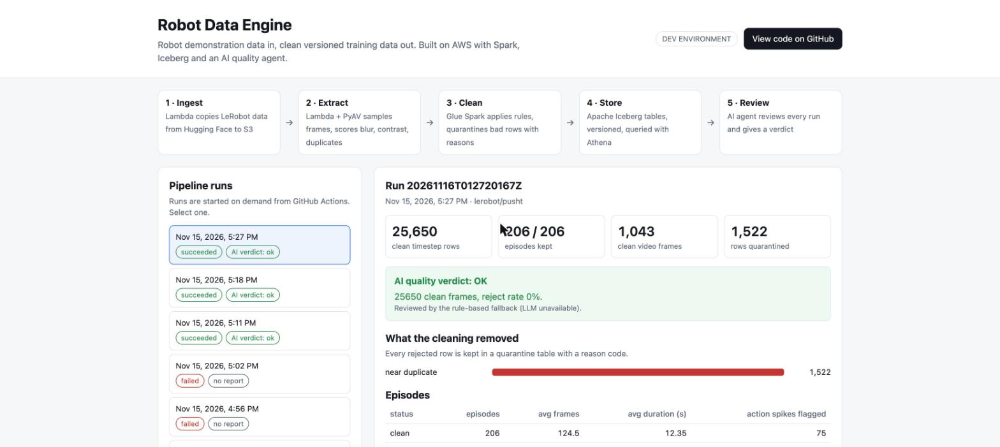

**14. Dashboard: frame gallery** (real PushT frames from S3 via short-lived private links).

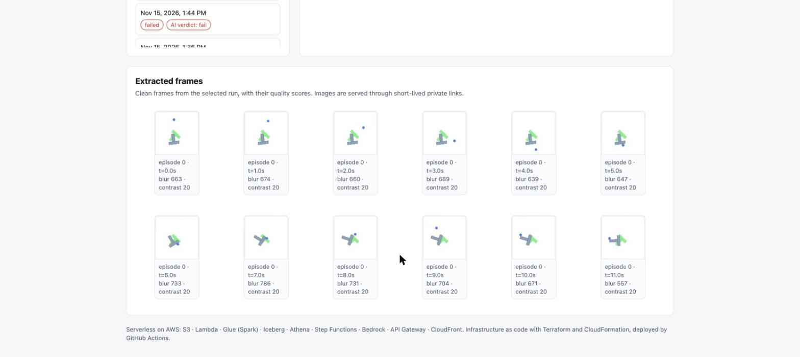

## Next steps

- PyTorch dataloader that reads a pinned Iceberg snapshot (reproducible training data)
- Train a LeRobot policy on raw vs curated data and compare success rates in simulation
- Enable Bedrock model access so the quality agent uses the LLM review
- More datasets (ALOHA), streaming path (Kinesis + Flink)
